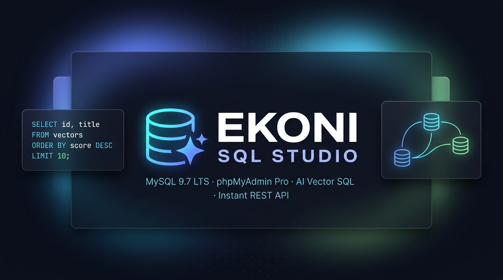
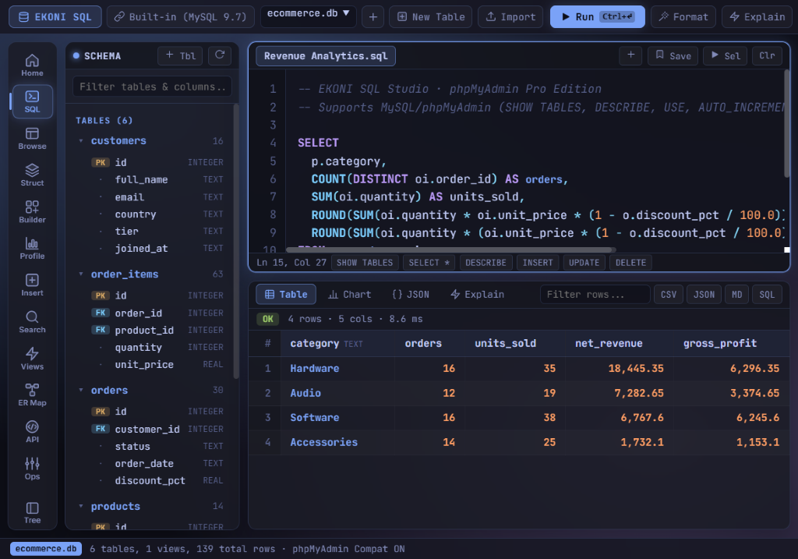
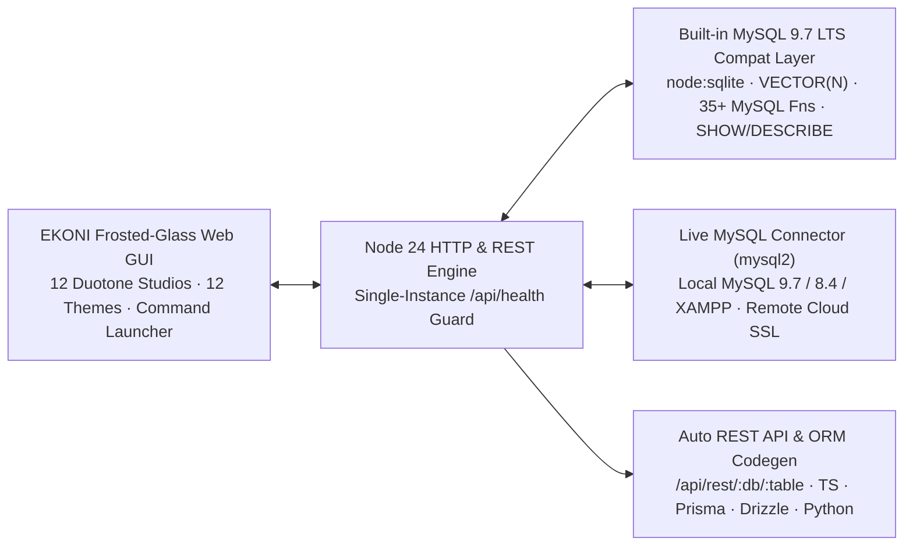

<div align="center">



# EKONI SQL Studio

**The next-generation SQL Startup Workbench — combining 100% of phpMyAdmin, MySQL 9.7 LTS AI Vector SQL, Live MySQL/Cloud SSL Connections, Visual Query Builder, Draggable ER Designer, Data Quality Profiler, and Instant REST APIs in one ultra-fast frosted-glass UI.**

<p>
  
  
  
  
  
  
</p>

<p>
  <a href="#-quick-start">Quick Start</a> •
  <a href="#-why-ekoni-sql-studio-vs-phpmyadmin">vs phpMyAdmin</a> •
  <a href="#-12-integrated-studios">12 Studios</a> •
  <a href="#-mysql-97-lts-ai-vector-sql">MySQL 9.7 Vector AI</a> •
  <a href="#-live-mysql-xampp--cloud-ssl">Live MySQL</a> •
  <a href="#-deploy-online-247">Cloud Deploy</a> •
  <a href="#-keyboard-shortcuts">Shortcuts</a>
</p>

</div>

---

## Live Workspace Preview

<div align="center">
  
</div>

---

## Why EKONI SQL Studio vs phpMyAdmin?

Built from scratch for modern SQL startups and developers who want **phpMyAdmin's complete control** with **Linear / Supabase / EKONI-grade speed and polish**.

| Capability | Classic phpMyAdmin | **EKONI SQL Studio** |
| :--- | :---: | :---: |
| **Works Instantly Offline (Zero MySQL Install Needed)** | No (Needs Apache + PHP + MySQL) | **Yes** — Node 24 built-in engine + MySQL 9.7 compat |
| **Connects to Live MySQL 9.7 / 8.4 / XAMPP / Cloud SSL** | Local config file editing | **Yes** — Built-in Connections Manager UI + SSL/TLS |
| **MySQL 9.7 AI `VECTOR(N)` & `DISTANCE()` Functions** | Limited | **Yes** — Native & Built-in Vector SQL support |
| **Inline Double-Click Cell Editing & Visual CRUD** | Basic | **Yes** — Instant inline edit, Duplicate, Bulk Delete |
| **Visual No-Code Query Builder (Auto FK JOINs)** | Legacy | **Yes** — Live syntax-highlighted SQL generation |
| **Instant Column Data Quality Profiler** | No | **Yes** — Completeness bars, Min/Max/Avg, Top-5 distributions |
| **Supabase-Style Live REST API (`/api/rest/:db/:table`)** | No | **Yes** — Auto-generated JSON API + live tester |
| **1-Click ORM & Type Codegen** | No | **Yes** — TypeScript, Prisma, Drizzle, Python Pydantic, Fetch, cURL |
| **Interactive Draggable ER Diagram** | Static Designer | **Yes** — Drag table nodes with live Bezier FK links |
| **Time-Travel Database Snapshots & Rollback** | No | **Yes** — 1-click point-in-time backup & restore |
| **Multi-Mode Chart Studio** | Basic | **Yes** — Instant Bar, Line, Horizontal & Donut SVG charts |
| **Smart Mock Data Seeder** | No | **Yes** — 1-click FK-safe realistic rows (10 / 25 at a time) |
| **Themes & Glassmorphism Studio** | Basic skins | **12 EKONI Themes** + **Aether Glass Studio (`Alt+A`)** |

---

## Architecture



---

## 12 Integrated Studios

Switch effortlessly from the sleek **duotone SVG left navigation rail**:

1. **Home / Overview** — Live KPI dashboard, full table matrix, and interactive `PRAGMA` switches (`foreign_keys`, `WAL` mode).
2. **SQL Console** — Multi-tab editor with syntax highlighting, smart schema autocomplete (`Ctrl+Space`), SQL formatter (`Alt+Shift+F`), `EXPLAIN QUERY PLAN` (`Ctrl+E`), Bookmarks, Cookbook, and persistent History (`Ctrl+R`).
3. **Browse** — Paginated table grid with **double-click inline cell edit**, Edit Row modal, Duplicate, Delete, Bulk Delete, Sort, and Quick Search.
4. **Structure** — Visual columns inspector (`PK`/`FK`/Null/Default/Drop), live **Add Column**, **Indexes Manager**, and copyable `CREATE TABLE` DDL.
5. **Visual Query Builder** — Build complex queries visually with **1-click FK auto-JOINs**, `WHERE` filters, `GROUP BY` aggregations, and real-time generated SQL.
6. **Data Quality Profiler** — Instant completeness meters, distinct counts, numeric stats (`Min`/`Max`/`Avg`/`Sum`), and Top-5 value frequency bars.
7. **Insert & Mock Seeder** — Dynamic row insert form with `NULL` toggles + **1-Click Mock Data Generator** for instant startup prototypes.
8. **Search (QBE)** — phpMyAdmin-style Query-By-Example per-column filters (`=`, `!=`, `LIKE %...%`, `>`, `<`, `IN`, `IS NULL`).
9. **Views & Triggers** — Visual creation and management of SQL `VIEW`s and `BEFORE` / `AFTER` `TRIGGER`s.
10. **Draggable ER Designer** — Interactive schema canvas with draggable table cards and live Bezier foreign-key arrows.
11. **Live REST API & ORM Codegen** — Auto-exposed `/api/rest/:db/:table` endpoint with live tester + copyable **TypeScript**, **Prisma**, **Drizzle ORM**, **Python Pydantic**, **JS Fetch**, and **cURL** code.
12. **Operations & Time-Travel Snapshots** — Rename, Copy, Truncate, Drop, `VACUUM`/`ANALYZE`, Import `.sql` / `.csv` / `.json`, Export Full SQL Dump, and **1-Click Snapshot & Rollback**.

---

## MySQL 9.7 LTS AI Vector SQL

Run modern **MySQL 9.7 LTS vector similarity queries** immediately — even offline without installing MySQL Server:

```sql
CREATE TABLE knowledge_base (
  id INT AUTO_INCREMENT PRIMARY KEY,
  title VARCHAR(120) NOT NULL,
  embedding VECTOR(3) NOT NULL
) ENGINE=InnoDB DEFAULT CHARSET=utf8mb4;

INSERT INTO knowledge_base (title, embedding) VALUES
  ('SQL Indexing Guide',   STRING_TO_VECTOR('[0.95, 0.12, 0.05]')),
  ('Vector Search Intro',  STRING_TO_VECTOR('[0.91, 0.20, 0.10]')),
  ('CSS Glassmorphism',    STRING_TO_VECTOR('[0.05, 0.10, 0.98]'));

SELECT
  title,
  VECTOR_DIM(embedding) AS dims,
  DISTANCE(embedding, STRING_TO_VECTOR('[1, 0, 0]'), 'COSINE') AS cosine_dist,
  VERSION() AS engine_version
FROM knowledge_base
ORDER BY cosine_dist ASC;
```

---

## Live MySQL, XAMPP & Cloud SSL

Click **`Connections`** in the top Waybar to connect to any real MySQL / MariaDB instance:

- **Local XAMPP (`127.0.0.1:3306`)** — Auto-detects `C:\xampp\mysql\bin\mysqld.exe` and offers a **1-click Start XAMPP MySQL** button right inside the UI.
- **Official Oracle MySQL Server (Windows)** — Double-click `install-mysql-latest.bat` to install `Oracle.MySQL` and `Oracle.MySQLShell` cleanly via `winget`.
- **Cloud MySQL (PlanetScale, Aiven, AWS RDS, Railway, DigitalOcean)** — Enter your host, port, credentials, enable **Use SSL / TLS**, test latency & server version, and click **Save & Connect**.

> **Security Note**: Saved connection profiles are stored locally in `data/connections.json` (excluded in `.gitignore`), and API responses never expose raw passwords to the UI.

---

## Quick Start

### Requirements
- **Node.js 24+** (or Node 22.5+ with native `node:sqlite`)

### 1. Clone & Run
```bash
git clone https://github.com/nadiw1245/ekoni-sql-studio.git
cd ekoni-sql-studio
npm install
npm start
```
Open **http://localhost:3344** in your browser.

### 2. Permanent Auto-Start on Windows (Survives Shutdown & Reboot)
Never lose your localhost server after turning off or restarting your PC:
- **Enable Boot Auto-Start**: Double-click `install-autostart.bat` (installs a silent launcher in Windows Startup with single-instance `/api/health` guard — zero console popups).
- **Stop Server**: Double-click `stop-server.bat`
- **Disable Boot Auto-Start**: Double-click `uninstall-autostart.bat`

### 3. Run with Docker
```bash
docker build -t ekoni-sql-studio .
docker run -p 3344:3344 -v ekoni_data:/app/data ekoni-sql-studio
```

---

## Deploy Online 24/7

Want a permanent public `https://` web URL that works from any device even when your PC is powered off?

<p>
  <a href="https://vercel.com/new/clone?repository-url=https://github.com/nadiw1245/ekoni-sql-studio">
    
  </a>
  &nbsp;
  <a href="https://render.com/deploy?repo=https://github.com/nadiw1245/ekoni-sql-studio">
    
  </a>
</p>

- **Vercel (Zero-Config Serverless)**: Preconfigured with `vercel.json` + `api/index.js` + Node 24 (`node:sqlite` in `/tmp`) and live Cloud MySQL SSL support.
- **Render (1-Click Blueprint)**: Click the button above or connect `nadiw1245/ekoni-sql-studio` in [Render Dashboard](https://dashboard.render.com) → **New +** → **Blueprint** — `render.yaml` and `Dockerfile` are preconfigured with `/api/health` checks.
- **Railway / Fly.io**: Deploy directly from this repository using the included production `Dockerfile`.

---

## Instant REST API Example

Every table in your workspace is instantly queryable over HTTP JSON:

```bash
curl "http://localhost:3344/api/rest/ecommerce.db/products?limit=5&sort=unit_price&order=DESC"
```

---

## Keyboard Shortcuts

| Shortcut | Action |
| :--- | :--- |
| `Ctrl + Enter` | Run full SQL script |
| `Ctrl + Shift + Enter` | Run highlighted SQL selection |
| `Ctrl + Space` | Smart SQL Autocomplete (tables, aliases, columns, functions) |
| `Alt + Shift + F` | Auto-format SQL query |
| `Ctrl + E` | Run `EXPLAIN QUERY PLAN` |
| `Alt + Space` / `Ctrl + K` | Open Unified Command Launcher |
| `Alt + A` | Open Aether Theme & Glass Studio (12 Themes + 6 Wallpapers) |
| `Ctrl + R` | Open Persistent Query History |
| `Alt + K` | Show Shortcuts Reference |

---

## Testing & Verification

```bash
npm run check   # Syntax validation across all JS files
npm test        # 15 automated test suites (SQL, MySQL 9.7 Vector AI, phpMyAdmin CRUD, Security Hardening)
```

---

## Contributing & License

Contributions, new EKONI themes, and SQL dialect improvements are welcome! See [CONTRIBUTING.md](CONTRIBUTING.md) and [SECURITY.md](SECURITY.md).

Released under the [MIT License](LICENSE).
